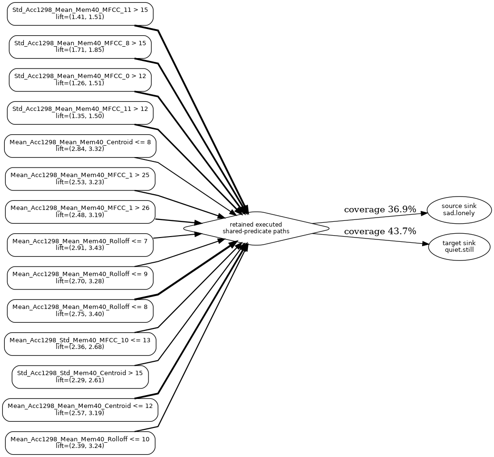

<div align="center">

# ms-DPG

**Explain how a multi-output tree ensemble shares its decisions across labels.**

[](https://github.com/sbarbonjr/ms-dpg/actions)
[](#installation)
[](LICENSE)



</div>

---

Multi-sink Decision Predicate Graphs (**ms-DPG**) extend Decision Predicate Graphs to binary multi-output random forests. Each executed root-to-leaf trace contributes label-specific decision mass to one sink per label. The result exposes directional conditions the fitted forest reuses across outputs.

| Question | ms-DPG output |
|---|---|
| Which label pairs reuse decision conditions? | **SPF matrix** |
| Which conditions are reused? | **Pair explanation** and **contracted view** |
| Do shared conditions enrich both labels or separate them? | **Lifts** |
| Does joint fitting change structure? | **Native vs BR comparison** |

## Installation

```bash
pip install git+https://github.com/sbarbonjr/ms-dpg.git
# Optional contracted-view rendering also requires system Graphviz.
```

## Quick start

```python
from sklearn.ensemble import RandomForestClassifier
from msdpg import MSDPG
from msdpg.datasets import make_scenario

X, Y = make_scenario("D1", random_state=0)
forest = RandomForestClassifier(n_estimators=200, random_state=0).fit(X, Y)
exp = MSDPG().fit(forest, X).explain()

print(exp.top_pairs())       # level 1: which ordered pairs share structure
pair = exp.pair(0, 1)
print(pair.shared.head())    # level 2: which predicates and their lifts
pair.contracted().to_graphviz("pair_view")
```

## Interpretation

SPF(A→B) is the fraction of B's decision mass on executed traces containing a predicate active for both A and B. It measures fitted decision structure, not statistical label dependence or perturbation-based leakage. A contracted view keeps high-mass co-enriching predicates and reports its sink coverage.

## Documentation and paper reproduction

- [`docs/concepts.md`](docs/concepts.md) defines sinks, SPF, lifts, and contracted views.
- [`docs/tutorial.ipynb`](docs/tutorial.ipynb) provides the *emotions* workflow.
- [`paper/`](paper/) contains the separated reproducibility scaffold and frozen protocols.

## Development

```bash
pip install -e .[dev]
pytest -q
```

## Citation

See [`CITATION.cff`](CITATION.cff).

## License

MIT.
