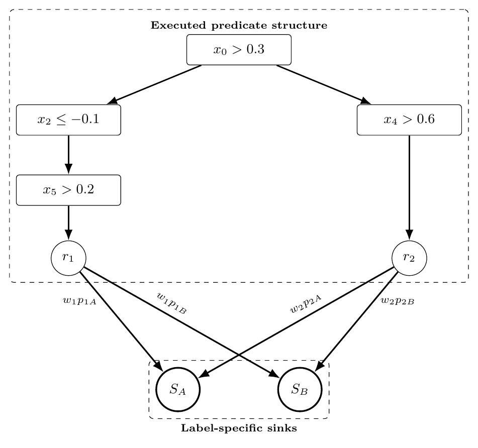
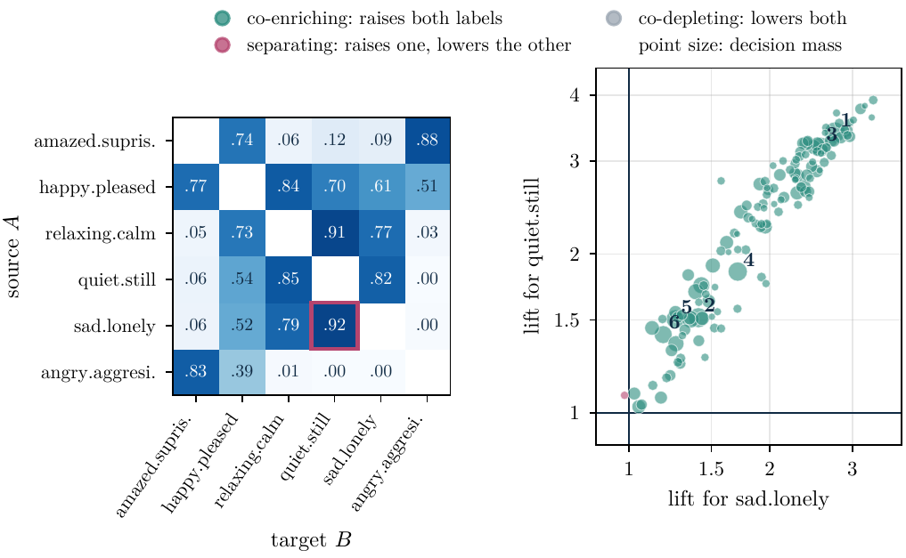
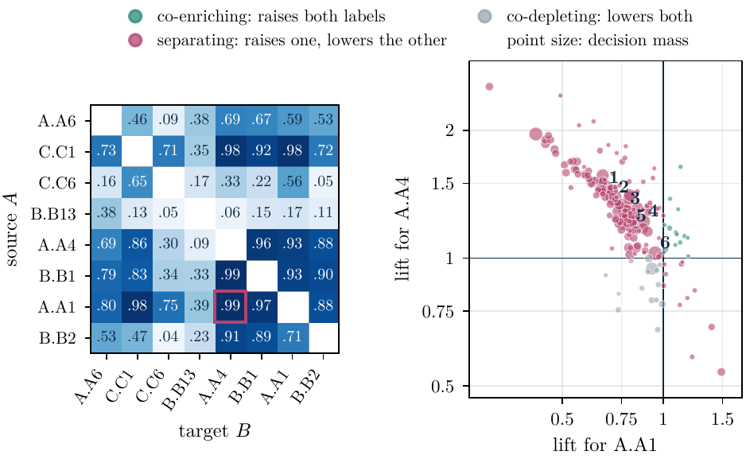
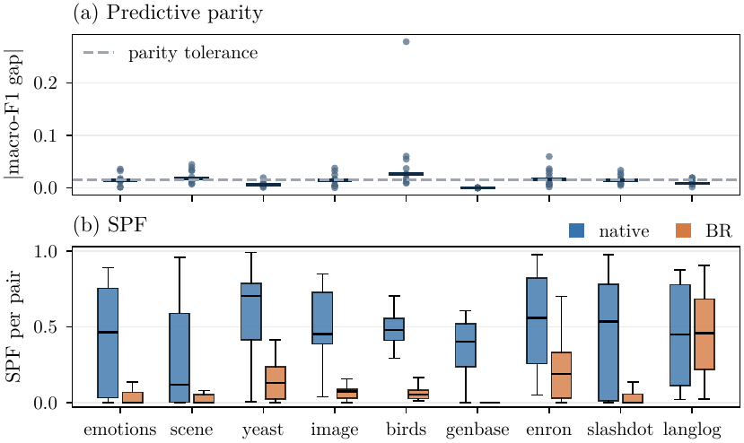

<div align="center">

# 🌳 ms-DPG

### Multi-sink Decision Predicate Graphs

**See which decision conditions a multi-label random forest reuses across its labels,<br>and whether it uses them to predict labels together or to choose between them.**

[](https://github.com/sbarbonjr/ms-dpg/actions)
[](#-installation)
[](https://scikit-learn.org)
[](LICENSE)

[Installation](#-installation) ·
[Quick start](#-quick-start) ·
[How it works](#-how-it-works) ·
[Reading an explanation](#-reading-an-explanation) ·
[Paper](#-reproducing-the-paper) ·
[Citation](#-citation)


<sub><i>Contracted ms-DPG of a random forest on <b>emotions</b>: the shared conditions behind <code>sad.lonely → quiet.still</code>,<br>the order in which the trees test them, and the label sinks that receive their decision mass.</i></sub>

</div>

---

## ✨ Why ms-DPG?

Feature attributions such as TreeSHAP or MDI explain **one label at a time**. A native
multi-output forest, however, decides **all labels through the same splits**. Two labels
can rest on the same feature through *opposite* conditions, or on the same condition
for *opposite* purposes, and per-label rankings cannot tell these cases apart.

ms-DPG extends [Decision Predicate Graphs](https://github.com/Meta-Group/DPG) with
**one sink per label**. Every executed root-to-leaf trace sends its decision mass to
each label separately, so the shared structure of the model can be read from a single
graph.

| You want to know… | ms-DPG gives you |
|---|---|
| Which label pairs does the forest decide through common conditions? | 🟦 **SPF matrix**: Shared Predicate Flow for every ordered pair |
| Which conditions are these, and in which order are they tested? | 🕸️ **Contracted view** of the pair |
| Does a condition raise both labels, or one at the expense of the other? | 🟢🟣 **Lifts**: co-enriching vs separating |
| Does fitting the labels jointly change this? | ⚖️ **Native vs Binary Relevance** comparison |

---

## 📦 Installation

```bash
pip install git+https://github.com/sbarbonjr/ms-dpg.git
```

Rendering contracted views needs [Graphviz](https://graphviz.org) (`apt install graphviz` or `brew install graphviz`).

---

## 🚀 Quick start

```python
from sklearn.ensemble import RandomForestClassifier
from msdpg import MSDPG
from msdpg.datasets import make_scenario

X, Y = make_scenario("D1", random_state=0)          # labels 0 and 1 share the condition x0 > 0
forest = RandomForestClassifier(n_estimators=200, random_state=0).fit(X, Y)

exp = MSDPG().fit(forest, X).explain()

print(exp.top_pairs())         # level 1: which ordered pairs share decision structure
exp.plot_spf()

pair = exp.pair(0, 1)
print(pair.shared.head())      # level 2: which predicates, with their two lifts
pair.plot_lifts()
pair.contracted().to_graphviz("pair_view")   # writes pair_view.dot / .pdf / .png
```

More in [`examples/`](examples/) and the step-by-step [tutorial](docs/tutorial.ipynb) on the *emotions* benchmark.

---

## 🧭 How it works

<table>
<tr>
<td width="46%"></td>
<td>

1. **Traces.** Every root-to-leaf path executed by the training data is recorded, with
   the in-bag mass of its leaf.
2. **Predicates.** Splits become directional predicates such as `x0 > 0.3`; thresholds of
   different trees are matched by 32 feature-wise quantile bins.
3. **Label sinks.** A leaf with mass *w* and positive fraction *p<sub>ℓ</sub>* sends
   *w·p<sub>ℓ</sub>* to the sink of label ℓ, for every label.
4. **Active predicates.** For each label, the predicates with the largest label-wise
   impurity gain.
5. **SPF(A→B)**: the share of B's decision mass on traces through a predicate active for
   both A and B.
6. **Lift λ<sub>ℓ</sub>(v)**: how much more likely label ℓ is among the mass passing
   through predicate *v* than in the whole forest.

</td>
</tr>
</table>

The graph reproduces the forest exactly: each sink accounts for all of its label's
decision mass, and the retained traces recover the forest's predicted probabilities.
Definitions with equations are in [`docs/concepts.md`](docs/concepts.md).

---

## 🔍 Reading an explanation

An explanation has **two levels**. On the left, the SPF matrix shows where the forest
reuses conditions across labels; the outlined pair has the highest SPF. On the right,
each shared predicate of that pair is placed by its two lifts.

<div align="center">

</div>

| Quadrant of the lift plot | Meaning |
|---|---|
| 🟢 both lifts > 1 | **co-enriching**: where the condition holds, the forest raises both labels |
| 🟣 one > 1, one < 1 | **separating**: the forest uses the condition to choose one label over the other |
| ⚪ both lifts < 1 | **co-depleting**: the condition lowers both labels |

### Same conditions, opposite purposes

A high SPF says that two labels share conditions, **not** that they are predicted
together. On the *enron* e-mail benchmark, the pair with the highest SPF (.99) has 94%
of its shared mass on **separating** predicates: the absence of words such as
*attached*, *draft* or *doc* raises one category and lowers the other.

<div align="center">

</div>

> [!NOTE]
> SPF describes the **fitted model**, not the data. It is not a measure of statistical
> label dependence, and it can be high even when the labels carry little signal. All
> masses are computed on the in-bag training sample.

---

## ⚖️ Native forests vs Binary Relevance

```python
from msdpg.compare import compare_architectures

cmp = compare_architectures(native_forest, br_model, X_train)
cmp.median_excess          # > 0: the native forest shares more decision structure than BR
```

Across nine multi-label benchmarks, native forests share more decision structure than
Binary Relevance on eight, including five of the six on which the two are at
predictive parity.

<div align="center">

</div>

---

## 🧩 API at a glance

| Object | Main members |
|---|---|
| `MSDPG(matching="quantile", bins=32, top_percent=25, minimum_fraction=0.05)` | `.fit(forest, X_train)`, `.explain()` |
| `Explanation` | `.spf`, `.top_pairs(k)`, `.active_predicates(label)`, `.pair(a, b)`, `.plot_spf()` |
| `PairExplanation` | `.spf`, `.shared`, `.separating_share`, `.plot_lifts()`, `.contracted(n_nodes=14)` |
| `ContractedView` | `.predicates`, `.coverage`, `.omitted_by_class`, `.to_graphviz(path)` |
| `msdpg.compare` | `compare_architectures(native, br, X_train)` |

Supported models: fitted `RandomForestClassifier` with multi-output binary targets
(native), and `MultiOutputClassifier` of random forests (Binary Relevance; lifts and
contracted views are defined for native forests only).

---

## 📄 Reproducing the paper

The [`paper/`](paper/) folder is separate from the library. It contains a pinned
environment, the protocols of every analysis, and one `make` target per table and
figure.

```bash
cd paper
conda env create -f environment.yml && conda activate msdpg-paper
make check
```

---

## 🛠️ Development

```bash
pip install -e .[dev]
pytest -q                 # unit, property and parity tests
```

---

## 📚 Citation

If you use ms-DPG, please cite:

```bibtex
@misc{barbonjunior2026msdpg,
  title  = {Explaining Cross-Label Decision Structure in Multi-Output Tree Ensembles},
  author = {Barbon Junior, Sylvio and Oliveira, Hiago F. F. and Gon{\c{c}}alves, Rafael Figueira
            and Lopes, Jessica Fernandes and Cerri, Ricardo},
  year   = {2026},
  note   = {Preprint}
}
```

See also [`CITATION.cff`](CITATION.cff).

## 🔗 Related

- [**DPG**](https://github.com/Meta-Group/DPG): Decision Predicate Graphs for single-output tree ensembles.

## 📜 License

[MIT](LICENSE) © 2026 the authors.
